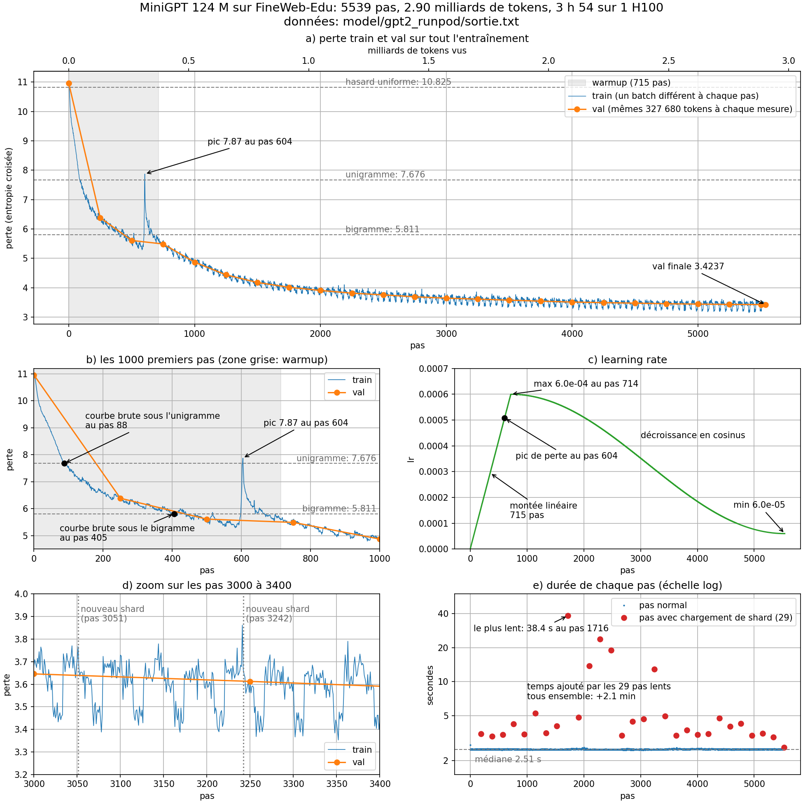
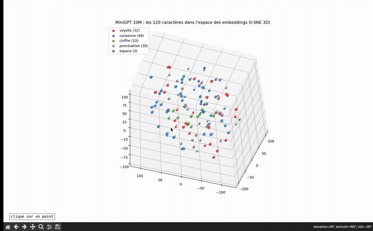
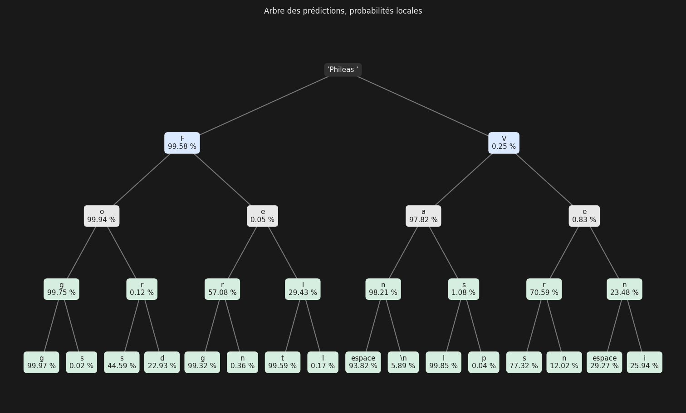

# Mini GPT from Scratch

Implémentation **de zéro** d'un modèle de langage de type GPT, en Python et PyTorch, **sans bibliothèque de Transformer** : chaque brique (tokenizer, attention causale, têtes multiples, blocs, positions, génération, boucle d'entraînement) est écrite à la main et vérifiée.

Le projet avance en deux temps :

1. **Un modèle au niveau caractère** entraîné sur **34 romans de Jules Verne** (18,2 millions de caractères, domaine public) : **10,8 M de paramètres**, entraîné en **7 minutes sur un GPU NVIDIA L40S**.
2. **Le même modèle à la taille de GPT-2 small** : **124 M de paramètres**, entraîné sur **2,9 milliards de tokens** de FineWeb-Edu en **3 h 54 sur un GPU NVIDIA H100**, pour environ **20 $** de location (RunPod).

Le même code tourne sur processeur, sur GPU Apple (`mps`) ou sur GPU NVIDIA (`cuda`), sans modification. Le projet étudie aussi les **limites** du modèle : ce qu'il « sait » (*knowledge probing*), puis l'abstention « je ne sais pas » et l'appel d'outil.

**Statut : en développement**, réimplémentation pas à pas, une brique par étape (voir la feuille de route).

---

## GPT-2 small sur FineWeb-Edu (124 M de paramètres)



### Réglages

| | |
|---|---|
| paramètres | **124 462 417** |
| architecture | 12 blocs × 12 têtes, 768 dimensions, contexte 1 024 tokens, LayerNorm avant l'attention et le feed-forward, table partagée entre l'embedding et la sortie, initialisation N(0 ; 0,02) |
| tokenizer | GPT-2 (`tiktoken`), 50 257 tokens ; un tokenizer BPE est aussi écrit à la main dans [`bpe.py`](bpe.py) |
| données | [FineWeb-Edu](https://huggingface.co/datasets/HuggingFaceFW/fineweb-edu) (4 fichiers de `sample-10BT`) découpé en shards de 100 M tokens : **2,90 milliards** pour l'entraînement (une seule époque), 100 M pour la validation |
| batch | **524 288 tokens par pas** : 32 micro-batchs de 16 × 1 024 tokens, gradients accumulés |
| optimiseur | AdamW, learning rate 6 × 10⁻⁴ → 6 × 10⁻⁵ (montée linéaire sur 715 pas, puis cosinus), weight decay 0,1 sur les tables 2D |
| calcul | bf16 (`torch.autocast`), attention en un appel (`F.scaled_dot_product_attention`) |
| matériel | 1 GPU H100 SXM (RunPod), **2,51 s par pas**, soit environ 209 000 tokens/s |
| robustesse | checkpoint tous les 500 pas, reprise automatique au dernier checkpoint, arrêt automatique du serveur à la fin |
| résultat | 5 539 pas, perte train **3,426**, validation **3,424** |

### Ce que montre l'entraînement

- **Trois pertes de référence** (panneau a), mesurées sur les mêmes 327 680 tokens que la validation : le hasard uniforme (ln 50 257 = 10,82), l'**unigramme** qui ne connaît que la fréquence de chaque token (7,68) et le **bigramme** qui devine un token d'après le précédent (5,81). La perte d'entraînement passe sous l'unigramme au **pas 88** (47 M de tokens lus) et sous le bigramme au **pas 405** (213 M) ; les deux passages sont marqués sur le panneau b.
- À 3,424, le modèle hésite en moyenne entre **31 tokens** à chaque prédiction (e^3,424), contre 50 257 au départ.
- **Pas de surapprentissage** : chaque token d'entraînement n'est lu qu'une fois, et la perte de validation reste collée à la perte d'entraînement du début à la fin.
- **Une instabilité au pas 604** (panneau b), en fin de montée du learning rate : la perte passe de 5,4 à 7,87 pendant 9 pas, puis revient à son niveau d'avant au pas 734. L'entraînement s'en remet seul ; cet entraînement n'utilise pas de *gradient clipping* (GPT-2 et GPT-3 limitent la norme du gradient à 1,0).
- **La perte d'entraînement oscille** d'un pas à l'autre (panneau d) parce que chaque pas lit un batch différent ; la validation, mesurée toujours sur les mêmes tokens, est lisse.
- **Les 28 pas les plus lents** (panneau e) sont des chargements de shard, de +0,7 à +36 s chacun ; le 29e chargement, celui du dernier shard (4,5 M de tokens), ne se voit presque pas. En tout, les chargements ajoutent 2,1 minutes sur 3 h 54.

Ces pertes sont calculées sur des tokens GPT-2 : elles ne se comparent pas aux pertes par caractère du modèle Verne ci-dessous.

---

## Modèle caractère sur Jules Verne (10,8 M de paramètres)

### Résultats

Corpus Verne complet, découpage **90 % entraînement / 5 % validation / 5 % test**, 5 000 pas d'AdamW. La perte est l'entropie croisée sur le jeu de **test**.

| étape | ce qui change | paramètres | contexte | perte test |
|---|---|---|---|---|
| hasard (120 caractères) | — | — | — | 4,787 |
| meilleur bigramme possible (calcul théorique) | — | — | 1 | 2,474 |
| MiniGPT, 1 tête d'attention | attention causale écrite à la main | 10 872 | 8 | 2,505 |
| MiniGPT, 4 têtes | attention multi-têtes | 10 872 | 8 | 2,403 |
| 3 blocs Transformer | feed-forward, résiduel, LayerNorm | 42 520 | 8 | 2,189 |
| + embeddings de position | le modèle connaît l'ordre des lettres | 42 776 | 8 | 2,089 |
| + contexte plus long | 32 caractères de mémoire | 43 544 | 32 | 1,852 |
| **modèle final** | 6 blocs × 6 têtes, 384 dimensions, projection, dropout 0,2, lr 1e-3, batch 64 | **10 831 224** | **256** | **1,245** |

- Les étapes ont été ajoutées **une par une**, chacune mesurée sur le même corpus et le même découpage.
- Empiler 3 blocs sans couche résiduelle ni LayerNorm **bloque** le modèle au niveau d'un unigramme (3,19) ; avec le résiduel seul, l'entraînement **diverge** (perte 21,5 au pas 3 000) ; avec les deux, il descend à 2,19.
- À 1,245, le modèle hésite en moyenne entre **3,5 caractères** à chaque pas (e^1,245), contre 12 pour le bigramme.
- Modèle final : 5 000 pas en 437 s sur L40S ; perte train 1,059, validation 1,216. L'écart train/validation grandit en fin d'entraînement : avec 16 M de caractères d'entraînement, 10 M de paramètres est proche de la limite utile du corpus.

### Texte généré par le modèle final

Température 1, départ sur un saut de ligne, aucune retouche (extrait de [`exemples/texte_genere_MiniGPT_10M.txt`](exemples/texte_genere_MiniGPT_10M.txt)) :

> «Vous voudrez quelles occasions, ma foi, mes amis, je m'ai à me regretter
> dans la barge.
>
> --Eh bien? ...»
>
> Lui-même, en somme, répondit Nell, qu'avaient vu y être à Calme-
> Branican. Et là, ces fanfares s'étaient, en montant un un signal
> arrivé à Stevenu, ou au milieu des nuits de l'attitude éprouvaient?
>
> Le capitaine Spade et le courant eurent l'ingénieur; c'étaient sa question
> sur cette solide royale, qui avaient été difficiles, [...]

Le modèle a appris l'orthographe, la ponctuation des dialogues et des noms de personnages de Verne (Nell, Branican, Karl Dragoch) ; le sens d'une phrase à l'autre reste hors de portée à cette taille.

L'effet de la **température** et du **top-k** sur le même modèle est visible dans [`exemples/`](exemples/) : à 0,5, le texte est correct mais se répète (« Le capitaine Nemo s'arrêta donc à l'endroit du capitaine Nemo ») ; à 1,5, des mots inventés et des chiffres apparaissent ; à 1,5 avec top-k 10, les absurdités disparaissent.

### Démo : l'espace des embeddings en 3D

Les 120 caractères du vocabulaire, tels que le modèle les a rangés après entraînement (projection t-SNE en 3D). La fenêtre est interactive et un clic sur un caractère affiche sa fréquence dans le corpus et entoure ses 5 plus proches voisins.



### Démo : l'arbre des prédictions

Ce que le modèle écrit après « Phileas » : à chaque étape, les 2 caractères les plus probables, avec leur probabilité sachant le chemin au-dessus. Le chemin « Fogg » l'emporte à chaque étape (99,58 % × 99,94 % × 99,75 % × 99,97 %, soit environ 99,2 % pour le mot entier).



### Ce que le modèle sait : *knowledge probing*

Le modèle reçoit un début de texte et quatre suites possibles (une seule juste) ; on regarde laquelle il juge la plus probable. Le hasard fait 25 %. Le jeu de test a été lancé **une seule fois**, après la mise au point sur un jeu séparé (méthode, fuites corrigées et empreintes des fichiers dans [`evals/README.md`](evals/README.md)).

| famille | exemple | test | hasard |
|---|---|---|---|
| personnages | `"Phileas "` → `Fogg` / `Zorn` / `Ogul` / `Land` | **39/53 = 73,6 %** | 25 % |
| faits | `"Le capitaine du Nautilus se nommait "` → `Nemo` / … | **11/39 = 28,2 %** | 25 % |
| contrôle (noms jamais lus) | `"Lazare "` → `Ceroni` / … | 1/5 = 20 % | 25 % |

- Le modèle retient l'association « prénom → nom » à partir d'une quinzaine d'occurrences dans le texte d'entraînement (37/38 au-delà, 2/15 en dessous).
- Il ne relie pas une description (« le gentleman du tour du monde ») au nom du personnage : les faits restent au niveau du hasard.

---

## Structure

```
mini_gpt/
├── tokenizer.py        vocabulaire caractère, encode / decode (texte ↔ identifiants)
├── dataset.py          extraits et batches (x, y décalé d'un caractère)
├── model.py            MiniGPT caractère : attention causale, têtes multiples, blocs
├── train.py            entraînement du modèle caractère, évaluation validation / test
├── generate.py         génération autorégressive, température, top-k
├── visualisation.py    embeddings en 3D (t-SNE), fenêtre interactive
├── probe.py            probabilités du caractère suivant, arbre des prédictions
├── tree.py             dessin de l'arbre des prédictions
├── eval_probing.py     évaluation des connaissances (questions à quatre choix)
├── evals/              jeu de questions, construction et résultats
├── bpe.py              tokenizer BPE écrit à la main (octets, fusions, encode / decode)
├── prepare_fineweb.py  téléchargement de FineWeb-Edu, tokens GPT-2, shards de 100 M tokens
├── model_gpt2.py       MiniGPT à la taille GPT-2 small (124 M de paramètres)
├── train_gpt2.py       entraînement GPT-2 small : accumulation, lr cosinus, bf16, checkpoints, reprise
├── exemples/           textes générés et figures
├── requirements.txt    bibliothèques et versions
├── ruff.toml           règles de style (ruff)
├── data/               corpus et shards, non versionnés
└── model/              poids entraînés et journaux, non versionnés
```

---

## Installation et utilisation

```bash
pip install -r requirements.txt
```

**Modèle caractère (Jules Verne)**

```bash
python train.py          # entraîne le modèle (GPU si disponible) et l'enregistre dans model/
python generate.py       # génère 1 000 caractères, enregistrés dans exemples/
python visualisation.py  # ouvre la fenêtre 3D des embeddings
```

**Le corpus** est constitué des 34 romans français de Jules Verne du [Projet Gutenberg](https://www.gutenberg.org/ebooks/author/60), concaténés dans `data/verne_complet.txt`, sans les en-têtes et licences Gutenberg ni les notes de numérisation, et sans les caractères très rares (moins de 20 occurrences). Un script de préparation automatique est en cours d'écriture.

**Modèle GPT-2 small (FineWeb-Edu)**

```bash
python prepare_fineweb.py                       # télécharge 4 fichiers de FineWeb-Edu, écrit 31 shards de tokens dans data/
python -u train_gpt2.py 2>&1 | tee sortie.txt   # entraîne (prévu pour un GPU NVIDIA) ; relancé, il reprend au dernier checkpoint
```

---

## Feuille de route

**Modèle caractère (Jules Verne)**

- [x] Tokenizer caractère et batches
- [x] Modèle bigramme de référence et boucle d'entraînement
- [x] Génération autorégressive
- [x] Attention causale (une tête), écrite à la main
- [x] Attention multi-têtes
- [x] Bloc Transformer : couche feed-forward, connexions résiduelles, LayerNorm, blocs empilés
- [x] Embeddings de position
- [x] Passage à l'échelle : 10,8 M de paramètres, GPU (L40S), projection, dropout
- [x] Échantillonnage : température, top-k
- [x] Visualisation des embeddings appris
- [x] *Knowledge probing* : jeu de questions dev / test, analyse d'erreurs

**GPT-2 small (FineWeb-Edu)**

- [x] Tokenizer BPE écrit à la main
- [x] Données : FineWeb-Edu en shards de tokens GPT-2
- [x] Modèle à la taille GPT-2 small : table partagée, initialisation, attention en un appel
- [x] Entraînement efficace : accumulation de gradient, learning rate warmup + cosinus, bf16, weight decay, checkpoints et reprise
- [x] Entraînement complet sur H100 (RunPod) et figure de l'entraînement
- [ ] Génération de texte avec le modèle GPT-2 small
- [ ] Représentation des embeddings des tokens
- [ ] SFT : apprendre au modèle à répondre aux questions (format assistant)
- [ ] DPO : apprendre des préférences (une meilleure et une moins bonne réponse)
- [ ] Abstention : dire « I don't know » quand il ne sait pas (SFT + DPO)
- [ ] Appel d'outil

---

Projet personnel d'apprentissage, inspiré de la série *Neural Networks: Zero to Hero* d'Andrej Karpathy.
