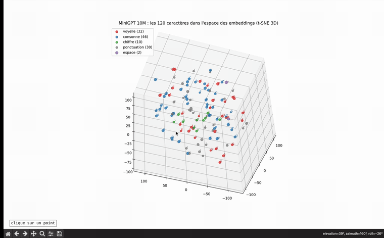
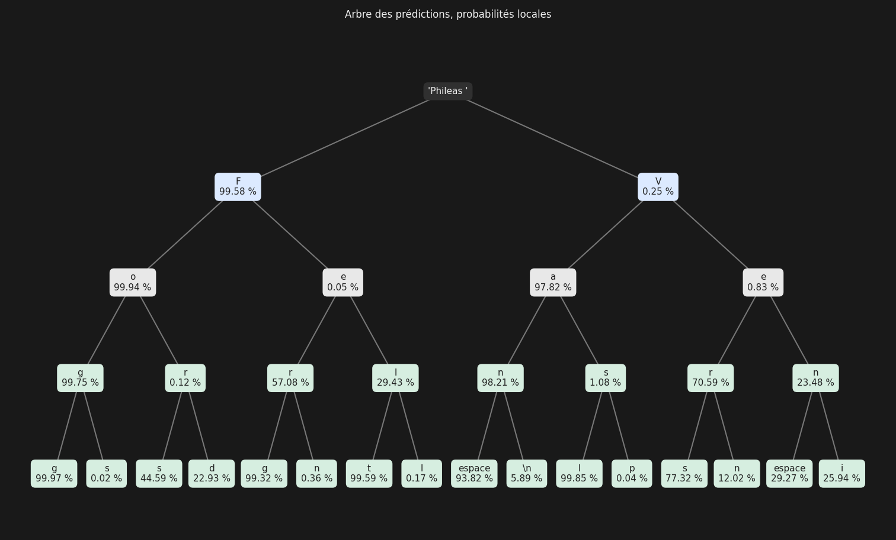

# Mini GPT from Scratch

Implémentation **de zéro** d'un modèle de langage de type GPT, au niveau caractère, en Python et PyTorch, **sans bibliothèque de Transformer** : chaque brique (tokenizer, attention causale, têtes multiples, blocs, positions, génération) est écrite à la main et vérifiée.

Le modèle est entraîné sur **34 romans de Jules Verne** (18,2 millions de caractères, domaine public). Le modèle final, **10,8 M de paramètres**, a été entraîné en **7 minutes sur un GPU NVIDIA L40S** (RunPod) ; le même code tourne sur processeur, sur GPU Apple (`mps`) ou sur GPU NVIDIA (`cuda`), sans modification.

Le projet va au-delà du pré-entraînement : il étudie aussi les **limites** du modèle (ce qu'il « sait » (*knowledge probing*), l'abstention « je ne sais pas », l'appel d'outil).

**Statut : en développement**, réimplémentation pas à pas, une brique par étape (voir la feuille de route).

---

## Démo : l'espace des embeddings en 3D

Les 120 caractères du vocabulaire, tels que le modèle les a rangés après entraînement (projection t-SNE en 3D). La fenêtre est interactive et un clic sur un caractère affiche sa fréquence dans le corpus et entoure ses 5 plus proches voisins.



---

## Démo : l'arbre des prédictions

Ce que le modèle écrit après « Phileas » : à chaque étape, les 2 caractères les plus probables, avec leur probabilité sachant le chemin au-dessus. Le chemin « Fogg » l'emporte à chaque étape (99,58 % × 99,94 % × 99,75 % × 99,97 %, soit environ 99,2 % pour le mot entier).



---

## Résultats

Corpus Verne complet, découpage **90 % entraînement / 5 % validation / 5 % test**, 5 000 pas d'AdamW. La perte est l'entropie croisée sur le jeu de **test**.

| étape | ce qui change | paramètres | contexte | perte test |
|---|---|---|---|---|
| hasard (120 caractères) | — | — | — | 4,787 |
| meilleur bigramme possible (calcul théorique) | — | — | 1 | 2,474 |
| MiniGPT, 1 tête d'attention | attention causale écrite à la main | 10 872 | 8 | 2,505 |
| MiniGPT, 4 têtes | attention multi-têtes | 10 872 | 8 | 2,403 |
| 3 blocs Transformer | feed-forward, résiduel, LayerNorm | 42 520 | 8 | 2,189 |
| + embeddings de position | le modèle connaît l'ordre des lettres | 42 776 | 8 | 2,089 |
| + contexte plus long | 32 caractères de mémoire | 43 544 | 32 | 1,852 |
| **modèle final** | 6 blocs × 6 têtes, 384 dimensions, projection, dropout 0,2, lr 1e-3, batch 64 | **10 831 224** | **256** | **1,245** |

- Les étapes ont été ajoutées **une par une**, chacune mesurée sur le même corpus et le même découpage.
- Empiler 3 blocs sans couche résiduelle ni LayerNorm **bloque** le modèle au niveau d'un unigramme (3,19) ; avec le résiduel seul, l'entraînement **diverge** (perte 21,5 au pas 3 000) ; avec les deux, il descend à 2,19.
- À 1,245, le modèle hésite en moyenne entre **3,5 caractères** à chaque pas (e^1,245), contre 12 pour le bigramme.
- Modèle final : 5 000 pas en 437 s sur L40S ; perte train 1,059, validation 1,216. L'écart train/validation grandit en fin d'entraînement : avec 16 M de caractères d'entraînement, 10 M de paramètres est proche de la limite utile du corpus.

### Texte généré par le modèle final

Température 1, départ sur un saut de ligne, aucune retouche (extrait de [`exemples/texte_genere_MiniGPT_10M.txt`](exemples/texte_genere_MiniGPT_10M.txt)) :

> «Vous voudrez quelles occasions, ma foi, mes amis, je m'ai à me regretter
> dans la barge.
>
> --Eh bien? ...»
>
> Lui-même, en somme, répondit Nell, qu'avaient vu y être à Calme-
> Branican. Et là, ces fanfares s'étaient, en montant un un signal
> arrivé à Stevenu, ou au milieu des nuits de l'attitude éprouvaient?
>
> Le capitaine Spade et le courant eurent l'ingénieur; c'étaient sa question
> sur cette solide royale, qui avaient été difficiles, [...]

Le modèle a appris l'orthographe, la ponctuation des dialogues et des noms de personnages de Verne (Nell, Branican, Karl Dragoch) ; le sens d'une phrase à l'autre reste hors de portée à cette taille.

L'effet de la **température** et du **top-k** sur le même modèle est visible dans [`exemples/`](exemples/) : à 0,5, le texte est correct mais se répète (« Le capitaine Nemo s'arrêta donc à l'endroit du capitaine Nemo ») ; à 1,5, des mots inventés et des chiffres apparaissent ; à 1,5 avec top-k 10, les absurdités disparaissent.

---

## Structure

```
mini_gpt/
├── tokenizer.py       vocabulaire, encode / decode (texte ↔ identifiants)
├── dataset.py         extraits et batches (x, y décalé d'un caractère)
├── model.py           Bigramme, Tete (attention causale), MultiTetes, FeedForward, Bloc, MiniGPT
├── train.py           entraînement (cpu / mps / cuda), évaluation validation / test, sauvegarde
├── generate.py        génération autorégressive, température, top-k
├── visualisation.py   embeddings en 3D (t-SNE), fenêtre interactive
├── exemples/          textes générés et visualisations
├── requirements.txt   bibliothèques et versions
├── ruff.toml          règles de style (ruff)
├── data/              corpus, non versionné
└── model/             poids entraînés, non versionnés
```

---

## Installation et utilisation

```bash
pip install -r requirements.txt
python train.py          # entraîne le modèle (GPU si disponible) et l'enregistre dans model/
python generate.py       # génère 1 000 caractères, enregistrés dans exemples/
python visualisation.py  # ouvre la fenêtre 3D des embeddings
```

**Le corpus** est constitué des 34 romans français de Jules Verne du [Projet Gutenberg](https://www.gutenberg.org/ebooks/author/60), concaténés dans `data/verne_complet.txt`, sans les en-têtes et licences Gutenberg ni les notes de numérisation, et sans les caractères très rares (moins de 20 occurrences). Un script de préparation automatique est en cours d'écriture.

---

## Feuille de route

- [x] Tokenizer caractère et batches
- [x] Modèle bigramme de référence et boucle d'entraînement
- [x] Génération autorégressive
- [x] Attention causale (une tête), écrite à la main
- [x] Attention multi-têtes
- [x] Bloc Transformer : couche feed-forward, connexions résiduelles, LayerNorm, blocs empilés
- [x] Embeddings de position
- [x] Passage à l'échelle : 10,8 M de paramètres, GPU (L40S), projection, dropout
- [x] Échantillonnage : température, top-k
- [x] Visualisation des embeddings appris
- [ ] *Knowledge probing*
- [ ] Abstention par fine-tuning supervisé
- [ ] Appel d'outil

---

Projet personnel d'apprentissage, inspiré de la série *Neural Networks: Zero to Hero* d'Andrej Karpathy.
